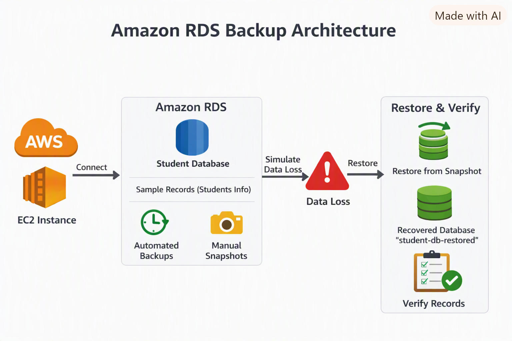
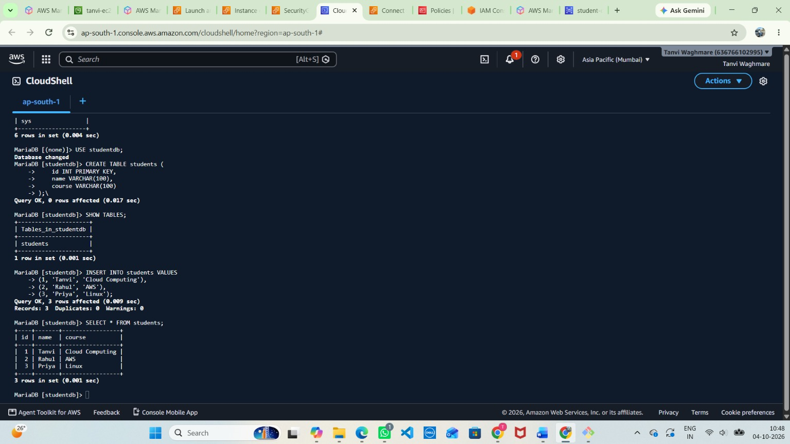
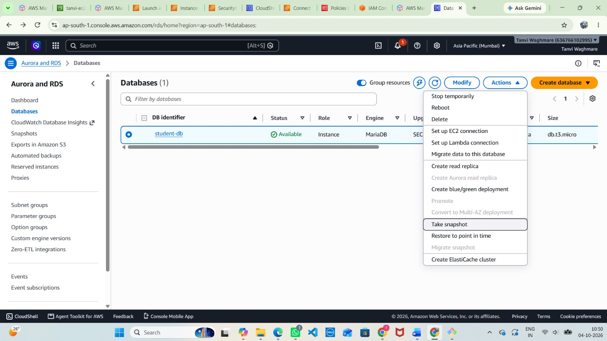
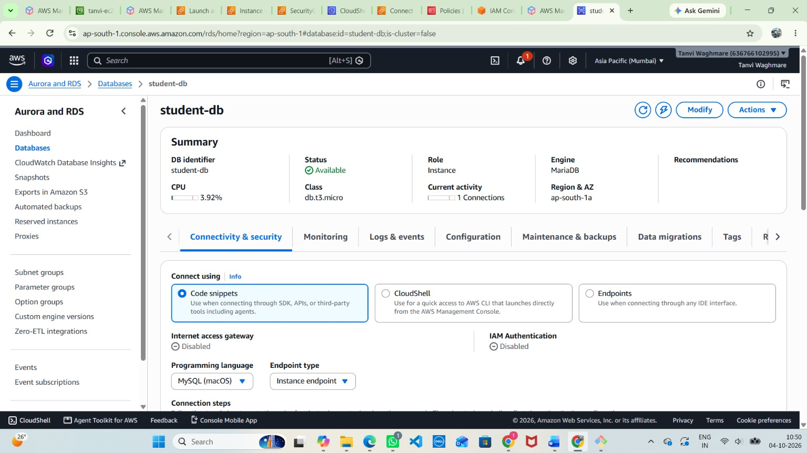
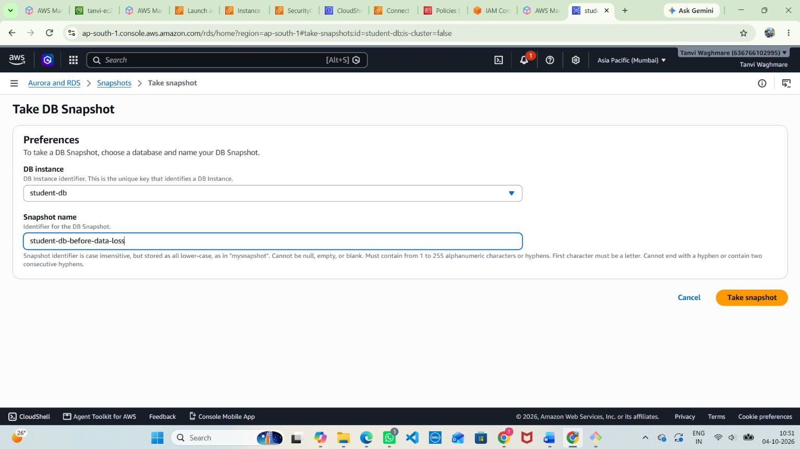
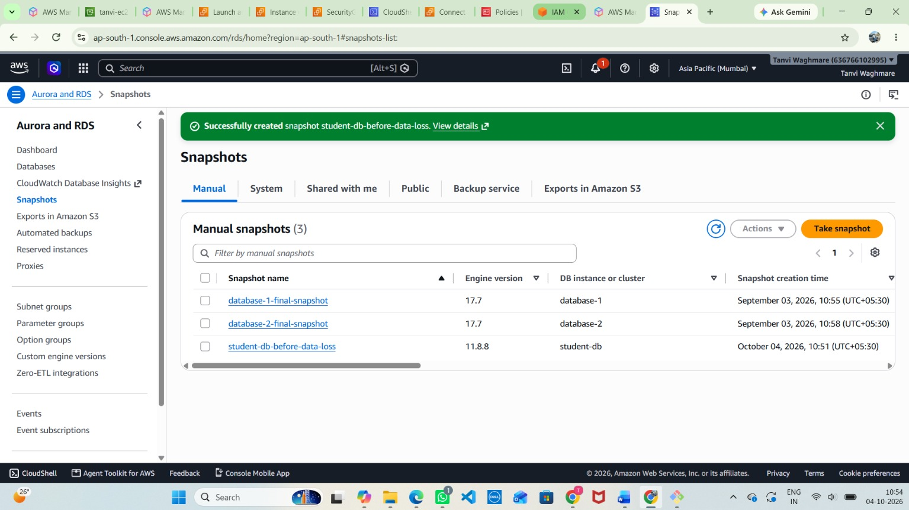
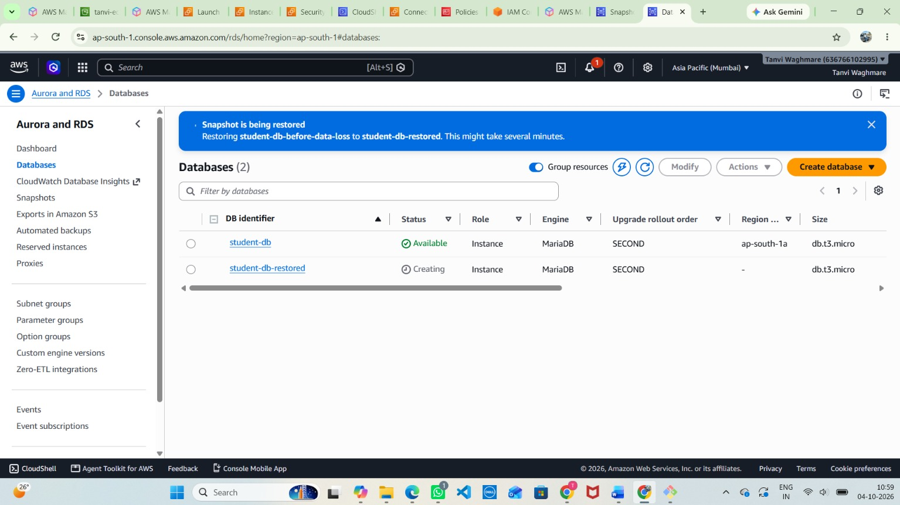

# AWS Project: Amazon RDS MySQL Backup & Recovery

## 📌 Project Overview

This project demonstrates how to create and manage an **Amazon RDS MySQL database**, configure automated backups, take manual snapshots, insert sample records, simulate data loss, and restore the database from a snapshot to verify recovery.

The workflow follows AWS best practices for **data durability and disaster recovery**.

---

## 🏗️ Architecture Diagram



**Flow:**

1. Amazon RDS MySQL instance → `student-db`
2. Student database with sample records
3. Manual snapshot creation
4. Data loss simulation (records deleted)
5. Restore from snapshot → `student-db-restored`
6. Verification of recovered records

---

## ⚙️ Implementation Steps

### 1. Create the RDS MySQL Database

1. Navigate to **RDS → Databases → Create database**.
2. Select the **MySQL** engine.
3. Configure the instance class (for example, `db.t3.micro`).
4. Enable **automated backups** for daily recovery points.

📸 **Screenshot: RDS Database Creation**



---

### 2. Insert Sample Records

1. Connect to the database using **CloudShell** or an EC2 client:

```bash
mysql -h <rds-endpoint> -u admin -p
```

2. Create a `students` table and insert sample records:

```sql
CREATE DATABASE studentdb;
USE studentdb;

CREATE TABLE students (
    id INT PRIMARY KEY,
    name VARCHAR(100),
    course VARCHAR(100)
);

INSERT INTO students VALUES
(1, 'Tanvi', 'Cloud Computing'),
(2, 'Rahul', 'AWS'),
(3, 'Priya', 'Linux');

SELECT * FROM students;
```

📸 **Screenshot: Sample Records Inserted**



---

### 3. Create a Manual Snapshot

1. In the RDS console, select the database and choose **Actions → Take snapshot**.
2. Name the snapshot, for example `student-db-before-data-loss`.
3. Wait until the snapshot status is **Available**. The snapshot is now stored for recovery.

📸 **Screenshot: Manual Snapshot Created**



---

### 4. Simulate Data Loss

1. Connect to the database and delete the records:

```sql
DELETE FROM students;
```

2. Verify that the table is empty:

```sql
SELECT * FROM students;
```

📸 **Screenshot: Data Deleted**



---

### 5. Restore from the Snapshot

1. In the RDS console, open **Snapshots**, select `student-db-before-data-loss`, and choose **Actions → Restore snapshot**.
2. Set the DB instance identifier to `student-db-restored`.
3. Wait until the restored DB status is **Available**.

> **Note:** A snapshot restore always creates a **new** DB instance with a new endpoint. It does not overwrite the original database.

📸 **Screenshot: Restored DB Instance**



---

### 6. Verify Recovery

1. Connect to the restored DB using its new endpoint.
2. Query the `students` table:

```sql
USE studentdb;
SELECT * FROM students;
```

3. The records should reappear exactly as they were before deletion.

📸 **Screenshot: Recovered Records**



---

## 🧪 Verification Results

- ✅ RDS MySQL instance created with automated backups enabled.
- ✅ Sample records inserted into the `students` table.
- ✅ Manual snapshot created successfully.
- ✅ Data loss simulated by deleting all records.
- ✅ Database restored from the snapshot as `student-db-restored`.
- ✅ All original records recovered and verified.

---

## 📖 Key Learnings

- Manual snapshots provide a reliable point-in-time recovery option.
- Automated backups enable daily recovery points and point-in-time restore.
- Restoring from a snapshot creates a new DB instance, so applications must be pointed to the new endpoint.
- Regular backups and recovery testing are essential for disaster recovery planning.

---

## 🧹 Cleanup

To avoid unnecessary charges:

1. Delete the restored DB instance `student-db-restored`.
2. Delete the original DB instance `student-db`.
3. Delete the manual snapshot if it is no longer needed.
